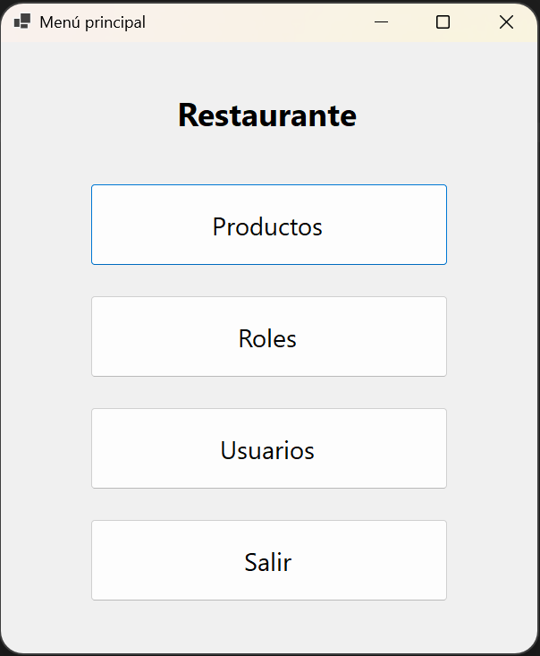
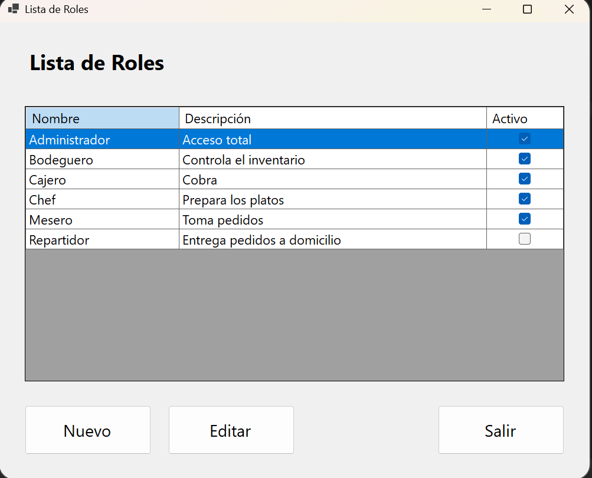
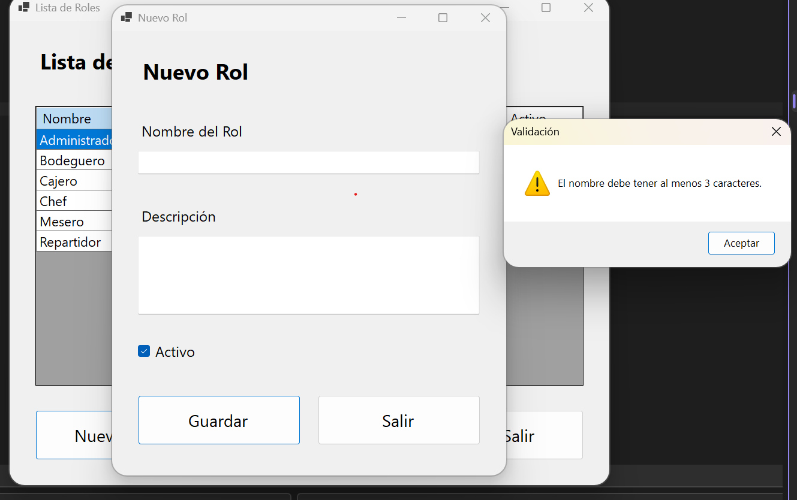
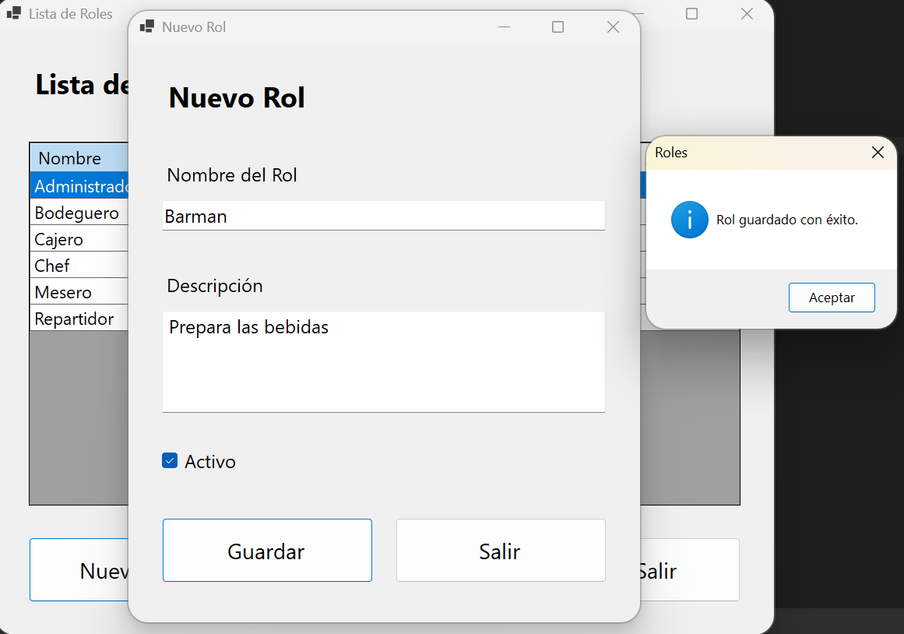
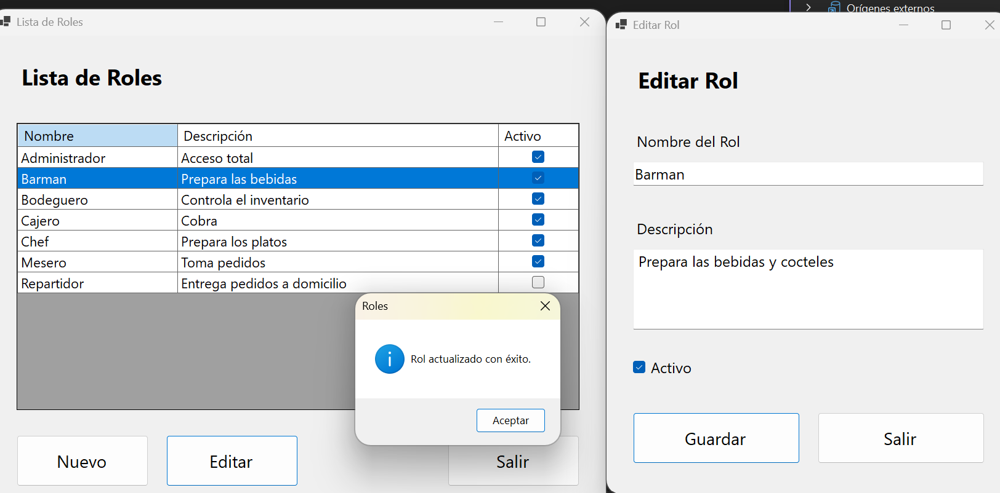
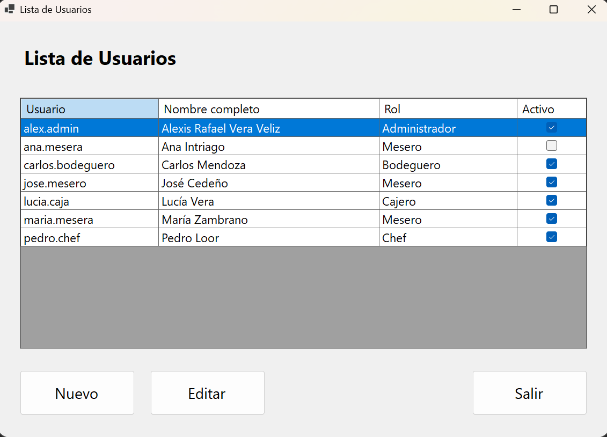
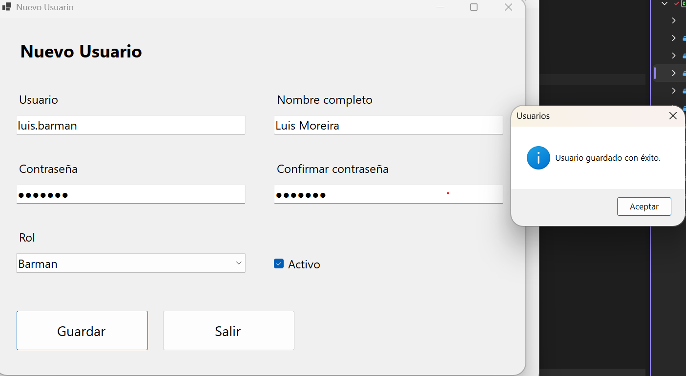
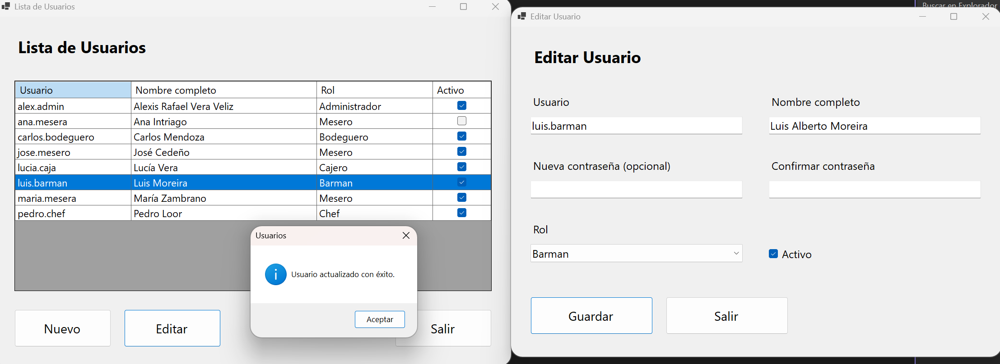
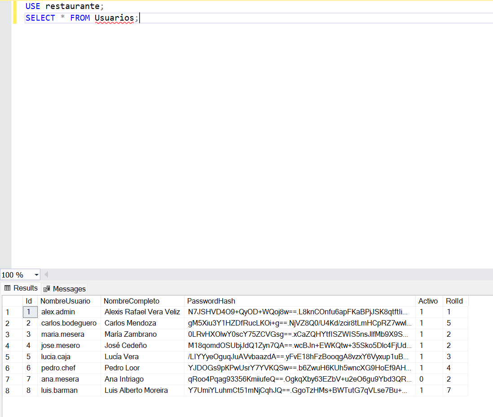

# Restaurante - CRUD con EF Core

Aplicación de escritorio en C# (Windows Forms, .NET 10) con
Entity Framework Core y SQL Server.

## Funciones

- Roles: crear, listar y editar
- Usuarios: crear, listar y editar
- Productos: crear, listar, editar y eliminar
- Validación de campos y mensajes de éxito o error
- Contraseñas guardadas con hash PBKDF2
- Consultas con LINQ, sin SQL concatenado

## Estructura en capas

| Carpeta | Contenido |
|---|---|
| Presentacion y Form1 | Formularios |
| Negocio | Servicios |
| Datos | DbContext |
| Datos/Entidades | Clases del dominio |
| Migrations | Migraciones de EF Core |
| BaseDatos | Script SQL |
| Evidencias | Capturas de pantalla |

## Instalación

1. Ejecutar `BaseDatos/restaurante.sql` en SQL Server Management Studio.
2. Revisar el nombre del servidor en `Datos/RestauranteDbContext.cs`.
3. Abrir la solución en Visual Studio.
4. Presionar F5.

## Datos de ejemplo

El script crea categorías, roles, productos y usuarios de prueba.

## Evidencias

### Menú principal

### Roles

### Usuarios

### Base de datos
